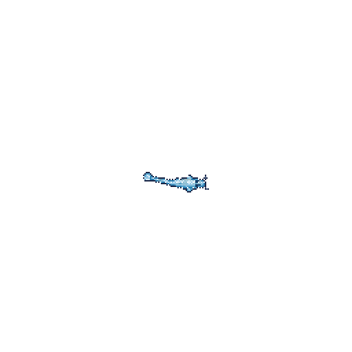

# Hi! I'm Fanizza Tahir 👋

Welcome to my GitHub! I'm a Computer Science student at James Madison University, graduating in May 2027.

- 🔭 I'm into quantum computing, AI, and space tech
- ⚛️ Right now I'm working on quantum cryptography research and a quantum LSTM paper
- ☁️ I've worked at Amazon (Reach Back DC) and was a Salesforce AI Studio Fellow
- 🚀 One day I wanna work at NASA and teach as a professor
- 🛠️ I also like building little ESP32 gadgets for fun

  

  

<a href="https://github.com/fttahir4#year-list-container">
  <picture>
    <source media="(prefers-color-scheme: dark)" srcset="cards/stats-dark.svg">
    
  </picture>
</a>
<a href="https://github.com/fttahir4?tab=repositories">
  <picture>
    <source media="(prefers-color-scheme: dark)" srcset="cards/languages-dark.svg">
    
  </picture>
</a>
 

📫 Find me at [fttahir.com](https://fttahir.com) or on [LinkedIn](https://linkedin.com/in/fttahir)
